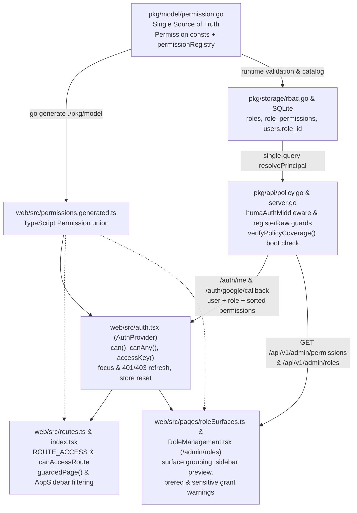

# Warehouse Parser RBAC Architecture & Implementation Guide

> **Core RBAC Self-Update Directive (Post-Review)**:
> Whenever changes are made to any **Core RBAC file** (listed in [Section 5](#core-rbac-files-watchlist))—including the capability catalog, authorization policy engine, SQLite role/grant schema or delegation rules, authentication/session contract, frontend `AuthProvider`, route guard mechanics, or the `/admin/roles` surface mapper—agents **MUST** update `docs/rbac.md` (and synchronize `AGENTS.md` and `README.md`) **after the user has reviewed and approved the core RBAC change**.
>
> - Do **not** let `docs/rbac.md` drift from shipped core RBAC behavior.
> - Do **not** document unreviewed or speculative design drafts in this file as shipped behavior; wait for user review/approval of the core RBAC change, then immediately bring `docs/rbac.md`, `AGENTS.md`, and `README.md` into sync.
> - If a task only adds a standard feature permission/page using the existing framework, update `README.md` (and `AGENTS.md` per repository guidelines); update `docs/rbac.md` only if core RBAC mechanics, conventions, or required touchpoints changed.

This document is the authoritative technical reference for `warehouse-parser`'s database-backed Role-Based Access Control (RBAC) system. For verb-naming rationale and Go ecosystem comparisons, see [`docs/rbac-best-practices.md`](rbac-best-practices.md). For the shipped endpoint-to-permission table, see [`README.md#api--permission-reference`](../README.md#api--permission-reference).

---

## 1. Architecture & Core Principles

### End-to-End Flow



### Security & Design Invariants

1. **Server-side authority & fail-closed boot**: Every `/api/*`, `/auth/*`, and `/health` route must declare an explicit `operationPolicy`. `Server.verifyPolicyCoverage()` (`pkg/api/policy.go`) panics at startup if any route is unclassified or duplicated, and `authorize()` rejects invalid policies with HTTP `403`. Frontend route guards and hidden buttons are UX only, never enforcement.
2. **Database re-resolution on every protected request**: The `warehouse_session` JWT cookie identifies the user (`claims.Email`) and expiry (`claims.ExpiresAt`). JWT role claims are **never** trusted for authorization. On every protected request, `Storage.ResolvePrincipal` loads the current user, role, and grants from SQLite, so role or grant changes take effect immediately on the next request without re-login.
3. **One role per user**: Each row in `users` references a single `roles.id` (`ON DELETE RESTRICT`).
4. **Transactional administrative serialization**: SQLite opens with `_txlock=immediate` (`pkg/storage/storage.go`). All role and user-assignment writes (`CreateRole`, `UpdateRole`, `DeleteRole`, `AssignUserRole`, `RemoveUser`) re-authorize the actor and inspect the target inside the serialized write transaction.
5. **Explicit local dev mode vs. production recovery guard**:
   - When `GOOGLE_CLIENT_ID` is empty, `Server.authDisabled()` is `true`: requests receive an implicit principal and `/auth/config` returns `{"auth_enabled": false}`. Only explicit `auth_enabled === false` enables the frontend local wildcard; auth/network errors never fall back to local mode.
   - When `GOOGLE_CLIENT_ID` is non-empty, `cmd/warehouse-server/main.go` refuses to start unless `SUPERADMIN_EMAILS` contains at least one non-blank recovery email.

---

## 2. Data Model, Roles & Delegation Boundaries

### SQLite Schema (`pkg/storage/roles_migration.go`)

```sql
CREATE TABLE roles (
    id INTEGER PRIMARY KEY AUTOINCREMENT,
    name TEXT NOT NULL UNIQUE COLLATE NOCASE,
    description TEXT NOT NULL DEFAULT '',
    is_system INTEGER NOT NULL
);

CREATE TABLE role_permissions (
    role_id INTEGER NOT NULL REFERENCES roles(id) ON DELETE CASCADE,
    permission TEXT NOT NULL,
    PRIMARY KEY(role_id, permission)
);

CREATE TABLE users (
    id INTEGER PRIMARY KEY AUTOINCREMENT,
    email TEXT NOT NULL UNIQUE COLLATE NOCASE,
    name TEXT NOT NULL DEFAULT '',
    picture TEXT NOT NULL DEFAULT '',
    role_id INTEGER NOT NULL DEFAULT 1 REFERENCES roles(id) ON DELETE RESTRICT,
    locale TEXT NOT NULL DEFAULT 'id',
    created_at DATETIME NOT NULL DEFAULT (datetime('now')),
    updated_at DATETIME NOT NULL DEFAULT (datetime('now'))
);
CREATE INDEX idx_users_email ON users(email);
CREATE INDEX idx_users_role_id ON users(role_id);
```

- **Non-reusable role IDs**: `roles.id` uses `AUTOINCREMENT` so a deleted role ID is never reused by a new role (preventing stale saves/assignments from hitting a different role).
- **Persistence guarantees**: `SyncMirror()` and `ClearData()` preserve `users`, `roles`, and `role_permissions`.
- **Legacy migration**: `migrateUserRoles()` atomically upgrades legacy `users.role` string columns to `role_id`, repairing missing `locale` columns if needed. Legacy roles normalizing via `LOWER(TRIM(role))` to `user`, `admin`, or `superadmin` become `user` (ID `2`, zero grants); all other values become `guest` (ID `1`). Subsequent startups never demote users or reseed grants.

### Built-In, Virtual & Custom Roles

| Role | ID | `is_system` | Grants Behavior | Editable / Deletable |
| :--- | :--- | :--- | :--- | :--- |
| `guest` | `1` | `1` | Always empty (`[]`); pending approval screen in UI. | Neither editable nor deletable. |
| `user` | `2` | `1` | Explicit grants in `role_permissions` (starts empty). | Description & grants editable (`PUT`); cannot be renamed or deleted. |
| `admin` | `3` | `1` | Implicit (`Principal.Implicit = true`, wire `["*"]`); holds every registered capability, including future ones. No `role_permissions` rows are consulted. | Neither editable nor deletable. |
| `superadmin` | virtual (`0` in UI) | virtual | Configured via `SUPERADMIN_EMAILS`. Applied in `resolvePrincipal` **only** to existing rows in `users` (a deleted or nonexistent email still receives `401`). Implicit access (`["*"]`). Name is reserved (`409` if used in role creation). | Managed strictly via environment configuration, not in SQLite. |
| Custom roles | `>= 4` | `0` | Explicit sorted `model.Permission` rows validated via `model.ValidPermission`. | Fully editable (`PUT`) and deletable (`DELETE`, blocked with `409` while assigned to any user). |

### Delegation & Escalation Boundaries (`pkg/storage/rbac.go`)

All admin mutations enforce these invariants inside the write transaction:

- **`coversRole(actor, roleID, grants)`**:
  - Implicit actors (`admin` / configured `superadmin`) cover all roles.
  - Non-implicit delegates can never cover `admin` (`roleID == 3`) and must themselves hold every grant in `grants`.
- **Role management (`canManageRole`, `roleActions`)**:
  - Non-implicit delegates cannot edit or delete their **own** role (`actor.RoleID != role.ID`) and cannot manage any role with grants they do not hold (neither its current grants nor its proposed new grants).
  - System roles (`is_system == 1`) cannot be deleted or renamed; only `user` (ID `2`) permits description and grant updates.
- **User management (`canManageUser`, `canAssignRole`)**:
  - Nobody—not even `admin` or `superadmin`—can modify or delete **themselves** (`actor.User.ID != target.User.ID`).
  - Nobody can modify or delete a **configured `superadmin`** (`!access.protected(target.User.Email)`).
  - Admins can manage peer `admin` accounts (assigning or demoting them), subject to the self and superadmin exclusions above.
  - Non-implicit delegates can only manage users whose current role they cover (`coversRole`), and can only assign roles they cover.
  - `user:create` is **approval-only**: it allows moving a `guest` (ID `1`) to `user` (ID `2`), and only if the actor covers `user`'s current grants. General role reassignment requires `user:update`.

---

## 3. Request Lifecycle & Backend Enforcement

### Authentication & Session Endpoints (`pkg/api/auth_handlers.go`)

| Endpoint | Method | Policy | Behavior |
| :--- | :--- | :--- | :--- |
| `/auth/config` | `GET` | `publicPolicy` | Returns `{"auth_enabled": false}` or `{"auth_enabled": true, "google_client_id": "..."}` (`Cache-Control: no-store`). |
| `/auth/google/callback` | `POST` | `publicPolicy` | Verifies Google ID token, upserts user row, resolves current principal, sets `warehouse_session` cookie (`HttpOnly`, `SameSite=Lax`, `MaxAge=86400`, `Secure` on HTTPS), returns `{"user": {...}}`. |
| `/auth/me` | `GET` | `publicPolicy` | Calls `s.authenticate(c)` directly (returns `400` if auth disabled, `401` if missing/invalid/deleted, `503` if storage unavailable). Available to pending guests. |
| `/auth/logout` | `POST` | `publicPolicy` | Expires `warehouse_session` cookie and returns `{"status": "ok"}`. |

Both `/auth/google/callback` and `/auth/me` emit the same non-cacheable payload (`sendSessionUser`):

```json
{
  "user": {
    "email": "operator@example.com",
    "name": "Operator",
    "picture": "https://...",
    "role": "user",
    "locale": "id",
    "permissions": ["dashboard:read", "order:read"]
  }
}
```

- Explicit grants are sorted (`[]` when empty). Implicit admins/superadmins receive `["*"]`.
- Missing/invalid JWT or a user deleted from SQLite returns **`401`** (deleted identity also clears `warehouse_session`).
- Authenticated user lacking required grants returns **`403`**.
- SQLite lookup failure returns **`503`**.

### Operation Policies (`pkg/api/policy.go`)

Four policy types exist:

| Constructor / Value | Meaning | Typical Use |
| :--- | :--- | :--- |
| `publicPolicy` | No session required. | `/health`, `/auth/*`. |
| `selfServicePolicy` | Valid signed-in user required (including pending `guest` / zero-grant `user`); no business grant needed. | `PUT /api/v1/user/locale`. |
| `allOf(p1, p2, ...)` | Principal must hold **every** listed `model.Permission`. | Almost all business & admin endpoints (e.g. `allOf(model.PermItemRead, model.PermItemExport)`). |
| `anyOf(p1, p2, ...)` | Principal must hold **at least one** listed `model.Permission`. | Multi-capability endpoints like `GET /api/v1/search` and `PUT /api/v1/admin/users/:email/role`. |

Registration wrappers:
- **Huma v2 operations**: Use `registerOperation(s, policy, huma.Operation{...}, handler)`. It validates the policy, records the route for `verifyPolicyCoverage()`, stores the policy in `op.Metadata["warehouse-policy"]`, and relies on `humaAPI.UseMiddleware(s.humaAuthMiddleware)`.
- **Raw Fiber endpoints** (SSE, CSV/JSON streams, auth, admin endpoints): Use `s.registerRaw(method, path, policy, handler)`. For `GET`, it automatically records `HEAD` as well.

### Scoped Data, Streaming & Browser-Local Capabilities

- **Scoped Search (`GET /api/v1/search`)**: Route policy is `anyOf(PermOrderRead, PermItemRead, PermCustomerRead)`. Inside the handler (`pkg/api/handlers.go`), `accessFromContext(ctx)` checks `access.principal.Can(...)` per category: explicit forbidden `type` requests return `403`, while `type=all` only queries authorized categories and returns empty arrays / zero totals for excluded ones.
- **Live SSE Re-Authorization (`GET /api/v1/sync/events`)**: Policy is `allOf(PermSyncRead)`. Before delivering events, the stream re-queries `s.resolveCurrentUser(...)`, verifies the same `userID`, `PermSyncRead`, and `time.Now().Before(expiresAt)`, and bounds socket write deadlines so blocked writes cannot outlive session expiry. Revocation, deletion, expiry, or lookup failure terminates the stream.
- **Browser-Local Hardware/Workspace Capabilities**: `barcode:print`, `logger_device:read`, and `logger_device:write` are registered in `pkg/model/permission.go` so they can be assigned to roles and inspected by the frontend, even though their actions run locally in the browser (label printing, WebHID USB communication). `logger_device:write` also requires `logger_device:read` and an active USB connection.

### Administration Endpoints (`pkg/api/access_handlers.go`)

| Endpoint | Method | Policy | Contract Notes |
| :--- | :--- | :--- | :--- |
| `/api/v1/admin/permissions` | `GET` | `allOf(PermRoleRead)` | Returns `{"permissions": [...]}` from `slices.Sorted(model.Permissions)`. |
| `/api/v1/admin/roles` | `GET` | `allOf(PermRoleRead)` | Returns roles ordered `is_system DESC, name COLLATE NOCASE, id` with per-role `actions: {update, delete}` computed for the caller. |
| `/api/v1/admin/roles` | `POST` | `allOf(PermRoleCreate)` | Accepts `{name, description, permissions}`; validates every permission via `model.ValidPermission`; `[]` clears grants; `*` rejected (`400`). |
| `/api/v1/admin/roles/:id` | `PUT` | `allOf(PermRoleUpdate)` | Atomically replaces metadata + explicit grants. `409` on name conflict or protected system role (`guest`/`admin`/renaming `user`). |
| `/api/v1/admin/roles/:id` | `DELETE` | `allOf(PermRoleDelete)` | `409` if system role or still assigned to any user. |
| `/api/v1/admin/users` | `GET` | `allOf(PermUserRead)` | Returns `users` (with server-computed `actions: {approve, assign, delete}`) and `assignable_roles` (`[{id, name}]`) without requiring `role:read`. |
| `/api/v1/admin/users/:email/role` | `PUT` | `anyOf(PermUserCreate, PermUserUpdate)` | Accepts `{role_id: number}`. Transactionally enforces `canManageUser` and `canAssignRole`. |
| `/api/v1/admin/users/:email` | `DELETE` | `allOf(PermUserDelete)` | Deletes user; active session cookie gets `401` and expires on next request. |

---

## 4. Frontend Authorization Architecture

### Generated Permission Union (`web/src/permissions.generated.ts`)

Generated by `go generate ./pkg/model` (executing `internal/permissiongen/main.go`). Never hand-edit it. Every `auth.can(...)`, `ROUTE_ACCESS`, `PERMISSION_PREREQUISITES`, and `SENSITIVE_PERMISSIONS` reference is type-checked against this union.

### `AuthProvider` (`web/src/auth.tsx`)

`useAuth()` exposes:

- `user()` — `undefined` (loading), `null` (unauthenticated), or `AuthUser` (`email`, `name`, `picture`, `role`, `permissions`, `locale`).
- `authConfig()` — `{ auth_enabled, google_client_id? }`.
- `loading()` / `failed()` — bootstrap and lookup-failure state.
- `can(permission)` — returns `true` iff `!failed()` and (`auth_enabled === false` OR `permissions` contains `'*'` OR `permission`).
- `canAny(...permissions)` — `permissions.some(can)`.
- `accessKey()` — memoized identity/grant fingerprint (`'local'` when auth disabled, `JSON.stringify([email, role, permissions])` when signed in, `''` otherwise).
- `login(credential)`, `logout()`, `refetch()`, `setUserLocale(locale)`.

Key runtime behaviors:
- **Live refresh without replay**: Refetches `/auth/config` + `/auth/me` on window `focus` and whenever `apiResponse()` (`web/src/api.ts`) reports HTTP `401` or `403` via `observeAuthorizationFailures`. Overlapping `refetch()` calls queue one follow-up pass (`refreshAgain`) so a revocation isn't masked by an older in-flight check.
- **Accurate upstream `401` isolation**: In `web/src/api.ts`, a `401` from `/api/v1/accurate/*` whose message is not `'authentication required'` is treated as an upstream Accurate session error (notified as `403` rather than clearing the warehouse session).
- **Clean session cutover**: Whenever `sessionKey` changes, `publish()` aborts in-flight API requests (`discardApiSession()`) and clears module-level stores (`clearAccurateState`, `clearServerDesigns`, `clearItems`).
- **Failed sign-out safety**: If `POST /auth/logout` fails, `logoutPending` stays `true`; pressing Retry or refocusing the window retries `logout()` instead of calling `/auth/me` and reopening the workspace.

### Routes, Pre-Mount Guards & Shell Navigation

- **`web/src/routes.ts`**:
  - `ROUTES`: canonical path constants and patterns.
  - `ROUTE_ACCESS`: maps every `WorkspaceRoute` to either a single `Permission`, a `readonly Permission[]` (any-of via `canAny`), or `'approved'` (any non-`guest` authenticated user, used by `/settings`).
  - `WORKSPACE_DESTINATIONS`: ordered fallback list used by `Home` (`web/src/index.tsx`) to decide where `/` lands when a user lacks `dashboard:read`. If none match, `Home` checks whether the user holds any `/settings` operational grant (`system:read`, `workday:*`, `accurate:*`, `sync:trigger`, `database:clear`) before falling back to `<WorkspaceAccess kind="unprovisioned" />`.
  - `canAccessRoute(auth, route)`: shared evaluator used by route guards, sidebar, `WorkspaceLink`, and Role Management previews.
- **`web/src/index.tsx` (`guardedPage`)**:
  - Wraps each workspace `<Route>` with `<Show when={canAccessRoute(auth, route) && key(auth)} keyed fallback={<WorkspaceAccess kind="denied" />}>`.
  - Runs **before** the page component mounts (preventing unauthorized API calls on deep links while keeping the URL intact).
  - By default `key` is `auth.accessKey()`, so any grant change cleanly remounts the page and discards stale resources. Pages that hold hardware handles across unrelated grant changes can pass a custom `key` (see `ROUTES.datalogger`, which keys on `[auth_enabled, email, logger_device:read, logger_device:write]` while resetting server state inside `<Show when={auth.accessKey()} keyed>`).
- **`web/src/App.tsx`**:
  - Public bypass for `/privacy` and `/terms`.
  - Auth gate order: `loading` spinner $\rightarrow$ `failed` (`<WorkspaceAccess kind="unavailable" />`) $\rightarrow$ unauthenticated (`<Login />`) $\rightarrow$ `USER_ROLE.GUEST` (`<PendingApproval />`) $\rightarrow$ authenticated shell.
- **`web/src/components/app-sidebar.tsx` & `WorkspaceLink.tsx`**:
  - `AppSidebar` filters every nav group item through `canAccessRoute(auth, item.href)` and hides empty groups.
  - `WorkspaceLink` renders an `<A>` when `canAccessRoute` passes, or a non-interactive `<div>` fallback (preserving visible data without dead links or hover underlines).

### Route-First Role Editor (`web/src/pages/roleSurfaces.ts` & `RoleManagement.tsx`)

Mounted at `${ROUTES.roles}/*rest` (`/admin/roles`, `/admin/roles/:id`, `/admin/roles/:id/:surface`, `/admin/roles/new`, `/admin/roles/new/:surface`):

- **Catalog source**: Fetches live capabilities from `GET /api/v1/admin/permissions`.
- **Surface resolution (`resolveRoleSurfaces`)**: Splits each permission at `:` into `{ resource, action, key }` and maps resources into the ordered `ROLE_SURFACES` array. Any permission whose `resource` is not listed in `ROLE_SURFACES` is automatically placed in the **`other` ("Other Capabilities")** fallback surface so newly registered backend permissions are always editable even before surface placement.
- **Intent grouping (`surfaceIntentBuckets` in `RoleManagement.tsx`)**:
  - **Elevated & Destructive (`intentAdmin`)**: permissions in `SENSITIVE_PERMISSIONS` **or** with action `delete`, `clear`, or `import`.
  - **View & Export (`intentView`)**: actions `read` or `export` (unless marked sensitive).
  - **Create & Modify (`intentOperate`)**: all other actions.
- **Quick tiers**: `None`, `Read` (selects items where `isReadLikeAction(action)` — currently `action === 'read'`), and `Full`, all clipped to `auth.can(grant)` to respect delegation bounds.
- **Sidebar visibility & prerequisites**: Uses `ROUTE_ACCESS` and `ROUTE_LABEL_KEYS` to preview which pages each surface unlocks, and `PERMISSION_PREREQUISITES` to flag missing prerequisites with one-click resolution.

---

## 5. Complete File Reference

### Core RBAC Files (Watchlist)

Modifying any of the files below triggers the **Core RBAC Self-Update Directive** at the top of this document (update `docs/rbac.md` after user review):

| Layer | File | Responsibility |
| :--- | :--- | :--- |
| Model | `pkg/model/permission.go` | `Permission` type, all capability constants, `permissionRegistry`, `Permissions` iterator, `ValidPermission`, `//go:generate` directive. |
| Model | `pkg/model/access.go` | `Principal` (`Can`), `Role`, `RoleActions`. |
| Model | `pkg/model/vocabulary.go` | Built-in role name constants (`RoleGuest`, `RoleUser`, `RoleAdmin`, `RoleSuperadmin`). |
| Codegen | `internal/permissiongen/main.go` | Generates `web/src/permissions.generated.ts` from `model.Permissions`. |
| Auth | `pkg/auth/auth.go` | JWT signing/validation (`warehouse_session`) and Google ID token verification. |
| Boot | `cmd/warehouse-server/main.go` | Enforces non-blank `SUPERADMIN_EMAILS` when `GOOGLE_CLIENT_ID` is set. |
| Storage | `pkg/storage/roles_migration.go` | `roles`, `role_permissions`, `users` DDL, legacy migration, and `AUTOINCREMENT` upgrade. |
| Storage | `pkg/storage/rbac.go` | `ResolvePrincipal`, delegation guards (`coversRole`, `canManageRole`, `canManageUser`, `canAssignRole`), transactional role & user CRUD. |
| API | `pkg/api/policy.go` | `operationPolicy`, `allOf`/`anyOf`/`publicPolicy`/`selfServicePolicy`, `registerOperation`, `registerRaw`, `verifyPolicyCoverage`, `authenticate`, `authorize`, `humaAuthMiddleware`. |
| API | `pkg/api/auth_handlers.go` | `/auth/config`, `/auth/google/callback`, `/auth/me`, `/auth/logout`, `sendSessionUser`. |
| API | `pkg/api/access_handlers.go` | `/api/v1/admin/permissions`, `/api/v1/admin/roles*`, `/api/v1/admin/users*` handlers & error mapping. |
| Frontend Core | `web/src/permissions.generated.ts` | Generated TypeScript `Permission` union (via `go generate ./pkg/model`). |
| Frontend Core | `web/src/auth.tsx` | `AuthProvider`, `useAuth`, session/grant refresh, store clearing, logout retry. |
| Frontend Core | `web/src/api.ts` | `observeAuthorizationFailures`, `discardApiSession`, Accurate upstream `401` handling. |
| Frontend Routing | `web/src/routes.ts` | `ROUTES`, `ROUTE_ACCESS`, `WORKSPACE_DESTINATIONS`, `canAccessRoute`. |
| Frontend Routing | `web/src/index.tsx` | `guardedPage`, `Home` landing resolver, router mount table. |
| Frontend Shell | `web/src/App.tsx` | Public route bypass, auth/guest gates, breadcrumb `routeTitle`. |
| Frontend Shell | `web/src/components/WorkspaceAccess.tsx` | `denied`, `unprovisioned`, and `unavailable` fallback states. |
| Frontend Shell | `web/src/components/WorkspaceLink.tsx` | Permission-aware link that degrades to a static `<div>`. |
| Frontend Admin | `web/src/pages/roleSurfaces.ts` | `ROLE_SURFACES`, `PERMISSION_PREREQUISITES`, `SENSITIVE_PERMISSIONS`, `ROUTE_LABEL_KEYS`, `resolveRoleSurfaces`, `findMissingDependencies`. |
| Frontend Admin | `web/src/pages/RoleManagement.tsx` | Route-first role editor UI, intent bucketing, cloning, stale-draft conflict handling. |
| Frontend Admin | `web/src/pages/UserManagement.tsx` | User directory UI consuming server-computed `actions` and `assignable_roles`. |

### Feature Consumer, Translation & Test Files

| Category | File | Responsibility |
| :--- | :--- | :--- |
| API Routes | `pkg/api/server.go` | Declares `operationPolicy` for every Huma and raw Fiber endpoint; calls `verifyPolicyCoverage()`. |
| Scoped Handlers | `pkg/api/handlers.go` | Per-category search gating (`handleSearch`) and SSE re-authorization (`handleSyncSSE`). |
| Sidebar | `web/src/components/app-sidebar.tsx` | `currentNavGroups` filtered via `canAccessRoute`, plus footer sync capability gates. |
| Locales | `web/src/i18n/en.ts`, `web/src/i18n/id.ts` | `roleManagement.groups`, `actions`, `notes`, `surfaces`, `surfaceHints`, `nav`, and `access` strings. |
| Tests | `pkg/api/rbac_test.go` | Protected-route sweep (`TestEveryProtectedRouteDeniesMissingIdentityAndNoGrants`), catalog/delegation/revocation/search/SSE integration tests. |
| Tests | `pkg/storage/roles_migration_test.go` | Legacy cutover, non-reusable IDs, and idempotent reopen tests. |
| Tests | `pkg/storage/rbac_concurrency_test.go` | Serialized concurrent revocation vs. admin write tests. |

---

## 6. Implementation Guide: Adding Permissions, New Pages & New Subpages

### Naming Conventions

- Always use `<resource>:<action>` in lowercase `snake_case` (e.g., `purchase_order:read`, `report:export`).
  - **The colon is mandatory**: `resolveRoleSurfaces` (`web/src/pages/roleSurfaces.ts`) ignores keys without `:`.
- Prefer `read`, `create`, `update`, `delete` for ordinary resources; use a domain verb (`export`, `import`, `pick`, `trigger`, `print`, `clear`, `write`) only when an operation warrants an independent grant (see [`docs/rbac-best-practices.md`](rbac-best-practices.md)).
- Choose by **effect**, not HTTP method (e.g., a `POST` batch query is still `:read`; a `GET` bulk download can require `:read` + `:export`).

### Part A: Registering a New Permission

Suppose we are adding a new `report:read` and `report:export` capability:

1. **Add constant and registry entry in `pkg/model/permission.go`**:
   ```go
   const (
       // ...
       PermReportRead   Permission = "report:read"
       PermReportExport Permission = "report:export"
   )

   var permissionRegistry = map[Permission]struct{}{
       // ...
       PermReportRead:   {},
       PermReportExport: {},
   }
   ```
   > Forgetting `permissionRegistry` causes `model.ValidPermission` to return `false`, omits the grant from `/api/v1/admin/permissions`, and panics in `checkPolicy` at startup.

2. **Regenerate the TypeScript union**:
   ```bash
   go generate ./pkg/model
   ```
   Verify `web/src/permissions.generated.ts` now includes `"report:export"` and `"report:read"`.

3. **Protect backend endpoints in `pkg/api/server.go`**:
   - For a Huma endpoint:
     ```go
     registerOperation(s, allOf(model.PermReportRead), huma.Operation{
         OperationID: "list-reports",
         Method:      http.MethodGet,
         Path:        "/api/v1/reports",
         Summary:     "List reports",
         Tags:        []string{"reports"},
     }, s.handleListReports)
     ```
   - For a raw Fiber endpoint (e.g. file download):
     ```go
     s.registerRaw(http.MethodGet, "/api/v1/reports/export", allOf(model.PermReportRead, model.PermReportExport), s.handleExportReports)
     ```

4. **Map the resource in `web/src/pages/roleSurfaces.ts`**:
   - Either append `'report'` to an existing surface's `resources` array in `ROLE_SURFACES`, or define a new `RoleSurfaceKey` and `ROLE_SURFACES` entry.
   - If one grant requires another, add it to `PERMISSION_PREREQUISITES`:
     ```ts
     export const PERMISSION_PREREQUISITES: Readonly<Partial<Record<Permission, readonly Permission[]>>> = {
       // ...
       'report:export': ['report:read'],
     };
     ```
   - If the grant is destructive or system-wide (and its action is not already `delete`, `clear`, or `import`), add it to `SENSITIVE_PERMISSIONS`.

5. **Add bilingual Role Editor copy in `web/src/i18n/en.ts` and `web/src/i18n/id.ts`**:
   - `roleManagement.groups.report` — group heading.
   - `roleManagement.actions.<action>` — only if introducing a brand-new action verb.
   - `roleManagement.notes["report:read"]` and `roleManagement.notes["report:export"]` — clear explanation of what data/actions the grant unlocks (explicitly note prerequisites if any).
   - If you added a new `RoleSurfaceKey`, add `roleManagement.surfaces.<key>` and `roleManagement.surfaceHints.<key>`.

### Part B: Adding a New Top-Level Page

After registering the permission(s) in Part A:

1. **`web/src/routes.ts`**:
   - Add the path to `ROUTES` (e.g. `reports: "/reports"`).
   - Add the access requirement to `ROUTE_ACCESS`:
     ```ts
     [ROUTES.reports]: 'report:read',
     // Or any-of when multiple capabilities can open the page:
     // [ROUTES.reports]: ['report:read', 'report:create'],
     ```
   - Add `ROUTES.reports` to `WORKSPACE_DESTINATIONS` if `/` should be able to redirect there when the user lacks Dashboard access.

2. **`web/src/pages/roleSurfaces.ts`**:
   - Add `[ROUTES.reports]: 'nav.reports'` to `ROUTE_LABEL_KEYS` (TypeScript enforces completeness via `satisfies Record<WorkspaceRoute, string>`).
   - Add `ROUTES.reports` to the relevant `ROLE_SURFACES[i].routes` array so `/admin/roles` displays accurate **"Visible in sidebar" / "Hidden from sidebar"** badges.

3. **`web/src/index.tsx`**:
   - Mount the route wrapped in `guardedPage`:
     ```tsx
     <Route path={ROUTES.reports} component={guardedPage(ROUTES.reports, Reports)} />
     ```

4. **`web/src/components/app-sidebar.tsx`**:
   - Add the navigation item to the appropriate group in `currentNavGroups`. Filtering by `canAccessRoute(auth, item.href)` happens automatically.

5. **`web/src/App.tsx` & i18n dictionaries**:
   - Add `if (path.startsWith(ROUTES.reports)) return t('nav.reports');` to `routeTitle`.
   - Add `nav.reports` to `web/src/i18n/en.ts` and `web/src/i18n/id.ts`.

6. **Inside the page component**:
   - Gate secondary actions (e.g. export button, edit/delete buttons) and optional secondary API fetches (e.g. area suggestions, related directories) independently using `auth.can(...)`.
   - Use `<WorkspaceLink route={ROUTES.orders} href={...}>` when linking to other workspace pages so inaccessible destinations degrade cleanly without broken links.

### Part C: Adding a New Subpage

Choose the pattern matching how the subpage is navigated:

#### Pattern 1: Dedicated Sub-Route URL (e.g. `/orders/:id`, `/datalogger-records/:id`)

1. Add the pattern to `ROUTES` and `ROUTE_ACCESS` in `web/src/routes.ts` (and a path helper if parameterized).
2. Add the pattern to `ROUTE_LABEL_KEYS` in `web/src/pages/roleSurfaces.ts`. Usually omit parameterized sub-routes from `WORKSPACE_DESTINATIONS` and `app-sidebar.tsx`.
3. Mount it in `web/src/index.tsx` with `guardedPage(ROUTES.reportDetailPattern, ReportDetail)`.
4. Add a `routeTitle` check in `web/src/App.tsx` **above** the parent prefix match (e.g., check `${ROUTES.reports}/` before `ROUTES.reports`).
5. Gate parent-page links to the subpage with `<WorkspaceLink>` or `canAccessRoute(auth, ROUTES.reportDetailPattern)`.

#### Pattern 2: Tab or Nested View Inside an Existing Page (e.g. `/datalogger?tab=config`)

Follow the pattern in `web/src/pages/datalogger/index.tsx`:

1. **Parent route entry (`web/src/routes.ts`)**: If a user should be able to reach the subpage **without** holding the parent's primary read grant, list all entry-granting capabilities as an array on the parent route (`anyOf` semantics via `auth.canAny`):
   ```ts
   [ROUTES.datalogger]: ['logger_session:read', 'logger_session:create', 'logger_device:read'],
   ```
2. **Per-tab access & safe fallback**:
   ```tsx
   const auth = useAuth();
   const canOverview = () => auth.can('report:read');
   const canSchedule = () => auth.can('report_schedule:read');

   const tabAllowed = (tab: string) => (tab === 'schedule' ? canSchedule() : canOverview());
   const activeTab = () => {
     const requested = searchParams.tab === 'schedule' ? 'schedule' : 'overview';
     return tabAllowed(requested) ? requested : (['overview', 'schedule'].find(tabAllowed) ?? 'overview');
   };
   ```
   - Guard both `<TabsTrigger>` visibility and `<TabsContent>` mounting with `tabAllowed(...)` so unauthorized tabs never mount or fire background requests.
   - Guard tab switching (`if (!tabAllowed(next)) return;`).
3. **Conditional `createResource` fetching**:
   ```tsx
   // Pass a boolean (or false when disabled) — NEVER an empty string ""
   const [data] = createResource(
     () => (canOverview() && currentFilter() ? currentFilter() : false),
     (filter) => fetchReports(filter),
   );
   ```
   > **SolidJS pitfall**: `createResource` only skips fetching when the source returns `false`, `null`, or `undefined`. Returning `""` still triggers the fetcher.

### Common Implementation Pitfalls

- **Do not lock independent write actions behind `read`**: If a user holds `foo:create` or `foo:update` without `foo:read`, keep the creation/update form reachable while gating only the list/history fetch on `foo:read` (and start update-only forms from an empty replacement draft rather than displaying fake defaults).
- **Reset local editing/modal state when permissions drop**: If a workspace toggles from editable to read-only (e.g., discarding a draft or losing a grant), clear open edit panels and bulk-edit modes.
- **Avoid coupling errors to unrelated form guards**: Place mutation error banners outside `create`/`update` form `<Show>` blocks if `delete` can run independently.
- **Rollout expectation**: Existing non-admin roles (`user` and custom roles) start **without** newly added permissions. After deployment, an admin must grant the new permission in `/admin/roles`; users receive it on their next API request without signing out.

---

## 7. Testing & Verification Checklist

Run these checks for every RBAC change, new permission, or guarded page:

```bash
# 1. Regenerate TypeScript permission union (if pkg/model/permission.go changed)
go generate ./pkg/model

# 2. Verify every /api/v1/* route fails closed (401 unauthenticated, 403 zero-grant)
go test -v ./pkg/api -run TestEveryProtectedRouteDeniesMissingIdentityAndNoGrants

# 3. Run full RBAC & storage suites with race detection
go test -race ./pkg/api -run 'Test.*RBAC|TestEveryProtectedRoute|TestRole|TestUser'
go test -race ./pkg/storage -run 'Test.*Role|Test.*RBAC'
go test -race ./...

# 4. Typecheck & build frontend (catches missing ROUTE_LABEL_KEYS, Permission typos, i18n keys)
cd web && pnpm exec tsc --noEmit && pnpm run build
```

When adding a new permission or protected route, also add test coverage in `pkg/api/rbac_test.go` asserting:
1. Unauthenticated request returns `401`.
2. Authenticated user with zero grants (or an unrelated grant) returns `403`.
3. User granted the required permission(s) succeeds (`200`/`201`/`204`).
4. Multi-permission endpoints (`allOf`) deny callers holding only a subset of grants.
5. `GET /api/v1/admin/permissions` includes the new key (verified automatically against `slices.Sorted(model.Permissions)`).
6. Update [`README.md#api--permission-reference`](../README.md#api--permission-reference) with the new endpoint-to-permission mapping.
